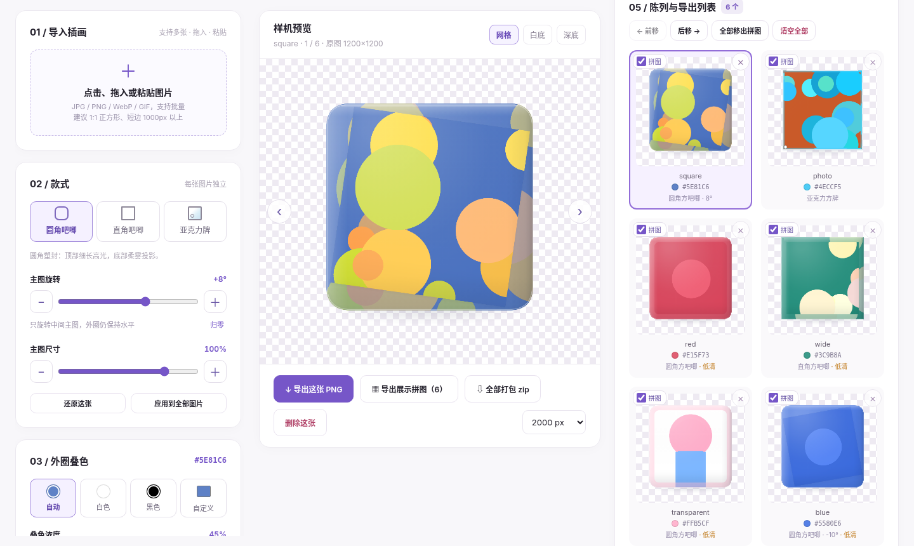

# 方吧唧 · Badge Studio

方形吧唧（圆角 / 直角）和亚克力方牌的商品样机生成器。上传插画，就能生成带柔雾高光和柔和阴影的效果图，导出透明 PNG 或白底陈列拼图。

**在线使用：** https://shuisutang.github.io/badge-studio/



## 怎么用

1. 首次打开只显示主窗口，点击中央上传区、拖入或粘贴（Ctrl+V）曲绘，可以一次导入多张；也可以点击「先用示例试试看」。
2. 常用的只有两组：「款式」（圆角 / 直角 / 亚克力、旋转、主图尺寸）和「叠色」（自动取主色 / 白 / 黑 / 自定义）。每张图单独保存，也可以「应用到全部图片」。
3. 「高级」里是外观预设（标准 / 亮面 / 哑光 / 平面）、裁切位置、材质细节和版权标，平时折叠着。
4. 陈列里每张图左上角的「拼图」勾选决定它进不进展示拼图和 zip；× 删除，「清空全部」一次删完，前移 / 后移调整顺序。
5. 导出：单张透明 PNG（1200 / 2000 / 3000 px）、白底展示拼图，或「全部打包 zip」。

上传后，上方「替换图片」只替换当前选中的图片，保留款式和编辑设置；「添加图片」继续导入新作品。删除最后一张或清空后回到中央上传区。

「搜索曲绘」支持舞萌 DX 和中二节奏，曲库、别称与曲绘均来自落雪咖啡屋的公开 API，不需要登录。可以按曲名、别称、作者或歌曲 ID 搜索，点击「导入」添加到陈列。结果显示曲绘原始像素；常见曲绘仅 300～400px，适合样机预览，导出大图可能偏糊，可用「替换图片」换成高清图。加载失败可重试，也可以继续上传本地图片。

仅在打开搜索时读取所选游戏曲库，本次页面内复用；输入关键词在本地匹配。曲绘按需读取，成功导入后连同原始图片保存在本机，刷新、编辑与导出不需要再次访问落雪。

亚克力在「款式 → 描边与画外背景」中可调整描边粗细、颜色、不透明度，以及画外背景明暗。粗细设为 0 可关闭描边；背景明暗只影响主图外圈。每张图片单独保存这些设置，2D 预览、3D 印刷层和导出使用同一份设置。

「中心主图缩放」低于 100% 时，主图和边界一起缩小，外圈叠色跟随边界；高于 100% 时，在主图区域内放大裁切。

手机上设置面板在屏幕下方，分「款式 / 叠色 / 高级」三个标签，预览一直留在上面。

作品会自动保存在当前浏览器里，刷新页面不会丢；点「清空」会连本机存档一起删除。

## 隐私

全部在浏览器本地处理。图片不会上传到任何服务器，页面也没有统计或追踪代码。

使用「搜索曲绘」时，浏览器会连接落雪获取公开曲库、别称与所选曲绘；搜索关键词在本地匹配，本地上传的图片不会发给落雪。

## 本地开发

需要 Node.js 20.19+ 或 22.12+。

```bash
npm install
npm run dev          # 本地开发 http://localhost:5173
npm test             # 单元测试（Vitest）
npm run build        # 类型检查 + 构建到 dist/
npm run test:e2e     # 端到端测试（Playwright，会先启动 vite preview）
```

本机已经装了 Chrome 的话，可以用 `CHROME_PATH=/usr/bin/google-chrome npm run test:e2e`；没有的话先运行 `npx playwright install chromium`。

推送到 main 后，GitHub Actions 会自动构建并部署到 GitHub Pages。

## 目录

```
src/model     数据模型、默认值、状态 store
src/image     图片解码与缩放（createImageBitmap，超大图只保留缩略代理）
src/color     自动取主色、叠色
src/render    吧唧 / 亚克力渲染器（预览、缩略图、导出共用同一个入口）
              lighting.ts 集中放阴影和高光参数（v3 已按官方实物照片调过）
src/three     「3D 预览」：three.js 单独分包，点按钮才加载；只用于查看，导出仍是 2D
src/export    单张 PNG、展示拼图、zip
src/persist   IndexedDB 自动保存
src/ui        面板、陈列、拖放等界面
tests/unit    纯逻辑单元测试
tests/e2e     回归、修复项、控件组合、移动端，以及与 v16 的像素对比
```

非官方同人工具，只用于制作你有权使用的图片。

Made by 幽酱 (@Shuisutang)
